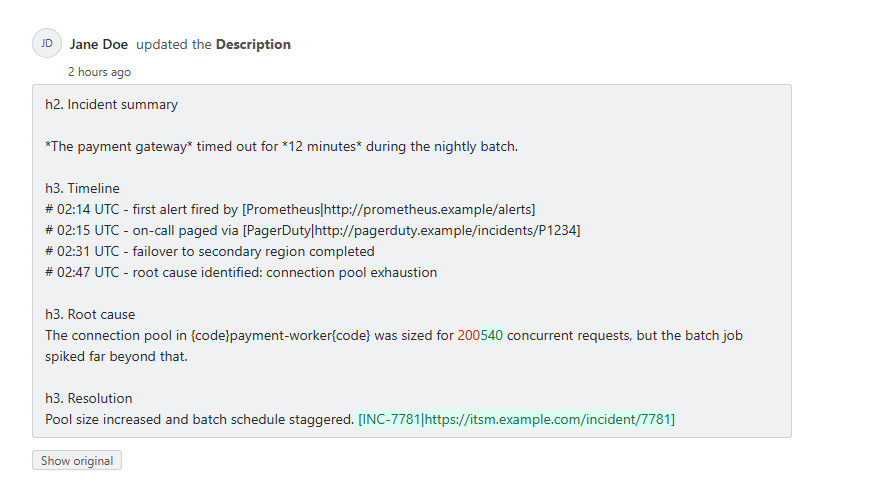
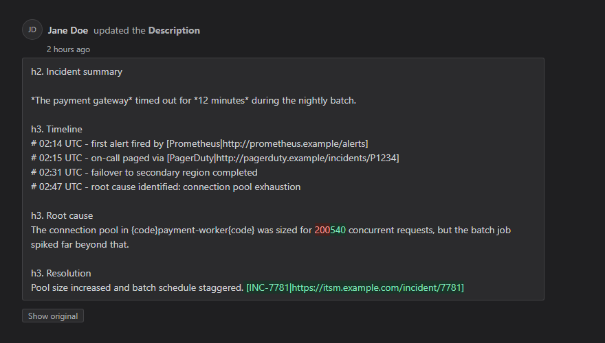

# Jira Diff Viewer

A browser extension (Chrome and Firefox) that shows highlighted inline diffs in the Jira History tab.
Jira Cloud renders description changes as two columns of raw wiki markup with no highlighting, so finding the actual edit means comparing both columns by eye.
Atlassian has declined to fix it: JRASERVER-20112 has been open since 2010.



The extension also follows Jira's dark theme automatically:



## Install

### Chrome

1. Clone this repo, or download it as a zip from GitHub and extract it.
2. Open `chrome://extensions`.
3. Enable Developer mode.
4. Click "Load unpacked" and select the extracted folder.
5. Reload any Jira tab that was already open; Chrome only injects content scripts on page load.

Chrome may warn about an "unrecognized manifest key" (`browser_specific_settings`) on the extensions page.
That key is Firefox metadata; the warning is harmless.

### Firefox

Download the signed `.xpi` from the [Releases](https://github.com/RedjonPrengzi/jira-diff-viewer/releases) page, then install it via `about:addons` → gear menu → "Install Add-on From File".
Reload any already-open Jira tab after installing.
From version 1.0.1 on, Firefox updates the extension by itself when a new release comes out.

Quick try from source, gone after a browser restart:

1. Open `about:debugging#/runtime/this-firefox`.
2. Click "Load Temporary Add-on" and select this folder's `manifest.json`.

Firefox has no permanent load-unpacked, so permanent installs must go through Mozilla's signing:

1. Create a free account on addons.mozilla.org and generate API credentials at <https://addons.mozilla.org/en-US/developers/addon/api/key/>.
2. Run `npx web-ext sign --channel=unlisted --api-key=YOUR_KEY --api-secret=YOUR_SECRET` in this folder.
3. The signed `.xpi` lands in `web-ext-artifacts/`.

Unlisted signing keeps the extension off the store; only people you hand the file to can install it.
Bump `version` in `manifest.json` before each re-sign, because AMO rejects duplicate versions.

That is all.
It works on any `*.atlassian.net` tenant, needs no configuration and no admin rights.
The `test/` directory is only needed for the test suite.

## How it works

- Anchors on history items via `data-testid="issue-history.ui.history-items.generic-history-item.history-item"`.
- Finds the old/arrow/new values row positionally: a row with exactly 3 element children, where the middle one is the arrow cell.
- The arrow cell is an icon, arrow glyphs, or an empty element. Jira Cloud draws the arrow with CSS on a childless div.
- This is intentionally independent of the Jira UI language, so German or English tenants behave the same.
- Diffs the extracted text at word level with the bundled diff-match-patch.
Text is split into word, whitespace and punctuation tokens, so highlights cover whole words rather than character fragments.
- Colors follow the Jira theme. They are read from Atlassian design tokens, so dark-mode tenants get dark-native colors and anything without tokens falls back to the original light palette.
- Renders a unified inline diff: additions in green (`.jdv-add`), deletions in red (`.jdv-del`).
- Unchanged runs over 600 characters collapse behind an expander; one click reveals the full run.
- Each processed entry gets a "Show original" / "Show diff" toggle that restores the untouched original DOM.
- The original markup is never destroyed: the row's children stay in place, only hidden via `display:none`, so Jira's React keeps its node references and the toggle restores them exactly.
- Processed rows are re-validated on every scan and rebuilt if Jira's React mutates or removes parts of them (self-heal).
- Any detection failure leaves the page exactly as Jira rendered it.
- No network calls, no permissions, no background worker. Everything runs locally.

## Maintenance

All selectors and constants live in `JDV.CONFIG` at the top of `content.js`.
When Atlassian changes the DOM, the fix is usually a one-line patch there.

## Releasing (maintainer)

1. Bump `version` in `manifest.json`.
2. Run `npx web-ext sign --channel=unlisted --api-key=YOUR_KEY --api-secret=YOUR_SECRET`; the signed `.xpi` lands in `web-ext-artifacts/`.
3. Create a GitHub release `vX.Y.Z` with that xpi attached.
4. Add the version and its asset URL as a new entry in `updates.json`, push.
5. Installed Firefox copies pick the update up within about a day, or immediately via `about:addons` → gear menu → "Check for Updates".

## Tests

```bash
node test/diff.test.js         # diff engine unit tests
node test/dom.test.js          # DOM processing tests (jsdom)
node test/integration.test.js  # real diff.js + content.js over the fixture DOM
```

First run `cd test && npm install` for jsdom.

Manual check: open `test/fixture.html` in a browser.
It mimics the Jira history DOM and exercises all expected cases.

## Licenses

- Extension code: MIT.
- Vendored diff-match-patch: Apache-2.0, see `vendor/LICENSE.diff-match-patch.txt`.

## Non-goals

- Comments.
- Side-by-side diff mode.
- Options page or user settings.
- Jira Server / Data Center.
- Store listings (Chrome Web Store, AMO); unlisted AMO signing is only the install mechanism for Firefox.
